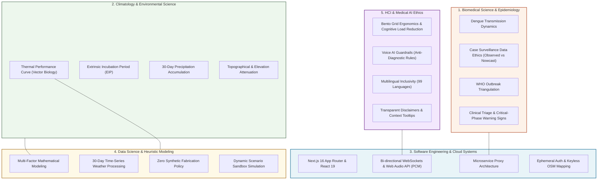
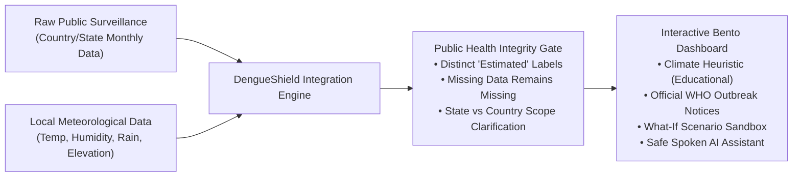
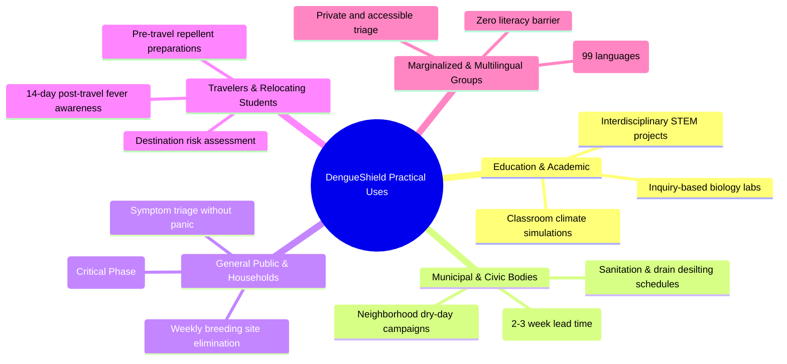

# DengueShield: An Interdisciplinary Group Project Report
**Course:** Interdisciplinary Project (IDP) — 3 Credits  
**Project Title:** DengueShield — Location-Intelligent Dengue Surveillance, Climate Suitability Modeling, and Multilingual AI Guidance  
**Project Nature:** Interdisciplinary Group Capstone  
**Disciplines Involved:** Software Engineering, Epidemiology & Biomedical Sciences, Climatology & Environmental Sciences, Applied Mathematics & Data Science, Human-Computer Interaction (HCI) & AI Ethics  

---

## Executive Summary

Dengue fever, caused by the dengue virus (DENV, serotypes 1–4) and transmitted primarily by *Aedes aegypti* and *Aedes albopictus* mosquitoes, is one of the fastest-growing vector-borne diseases globally. Addressing dengue transmission requires more than software engineering; it demands a deep synthesis of **epidemiological surveillance, meteorological science, quantitative biological modeling, and accessible human-computer interaction**.

**DengueShield** is an open-access, web-based interdisciplinary surveillance and simulation system designed to bridge the gap between complex public health datasets and everyday human decisions. The platform aggregates monthly public health surveillance records (Global Dengue Observatory and India's NCVBDC), ingests microclimatic observations (Open-Meteo), computes an illustrative vector suitability index based on biological thermal and hydrological curves, visualizes geographic context using Leaflet/OpenStreetMap, and provides a safe, spoken-voice AI consultation channel powered by Google Gemini Live over WebSockets in 99 languages.

A standout capability of DengueShield is its **Interactive Scenario Sandbox**, which functions as an educational laboratory enabling students and researchers to simulate hypothetical climate conditions—such as extreme heatwaves, unprecedented monsoon precipitation, or warming-induced vector migration to higher altitudes—to study vector ecology interactively.

---

## 1. How DengueShield is Truly Interdisciplinary

For a project to qualify as genuinely interdisciplinary, it cannot merely use software to display numbers; its core algorithms, architecture, and user safeguards must derive directly from the theories of multiple academic domains. DengueShield integrates five distinct fields:



### The 5 Disciplinary Pillars Detailed:

| Discipline | Academic Concept Applied | Exact Implementation in DengueShield |
| :--- | :--- | :--- |
| **1. Epidemiology & Biomedical Science** | **Vector Transmission & Case Harmonization**<br>Understanding *Aedes aegypti* transmission biology, surveillance reporting lags, and WHO clinical warning signs. | • Integrated Global Dengue Observatory (GDO) and India’s National Center for Vector Borne Diseases Control (NCVBDC).<br>• Enforced epidemiological integrity: labeling data as `Observed`, `Nowcast`, or `Backfilled`.<br>• Programmed triage protocols screening for life-threatening plasma leakage. |
| **2. Climatology & Environmental Science** | **Vector Thermal Performance & Hydrological Breeding Windows**<br>Mosquito biology depends strictly on temperature, humidity, and rainfall cycles. | • Formulated non-linear thermal curves ($S_T$ optimal between 22°C–32°C; cessation below 13°C).<br>• Hydrological thresholds (15–250mm rolling rainfall).<br>• Topographical altitude limits ($S_E$ tapers to 0 above 2,200m). |
| **3. Data Science & Applied Mathematics** | **Multi-Factor Heuristic Modeling & Non-Synthetic Data Handling**<br>Synthesizing discrete environmental parameters into a normalized compound index. | • Mathematical formulation:<br>$\text{Index} = S_T \times (0.35 + 0.65 S_H) \times S_R \times S_E \times 100$<br>• Refusal to fabricate synthetic numbers when regional health records are absent ("missing data remains missing"). |
| **4. Software Engineering & Systems Architecture** | **Modern Reactive Web Engineering & Audio Streaming**<br>Low-latency data pipelining, resilient error boundaries, and streaming WebSockets. | • Built on **Next.js 16** (Turbopack) and **React 19**.<br>• Real-time raw PCM Web Audio API pipeline (downsampling to 16kHz for upload, rendering 24kHz return).<br>• Server-side reverse proxy with TTL caching for API resilience. |
| **5. HCI & AI Ethics in Healthcare** | **Cognitive Ergonomics & Medically Safe AI Interaction**<br>Preventing self-diagnosis anxiety and ensuring non-expert readability. | • Responsive **Bento Grid** layout prioritizing cognitive clarity.<br>• System prompts forcing Gemini Live to maintain strict boundaries (no diagnosis, no prescription, immediate referral for emergency red flags).<br>• 99-language automated spoken recognition for low-literacy users. |

---

## 2. Theoretical Interdisciplinary Foundation

DengueShield resolves a fundamental interdisciplinary dilemma: **How do we present incomplete, delayed epidemiological surveillance data alongside local environmental factors without misleading citizens into believing the system is diagnosing them or predicting individual infection probability?**



### The Intersection of the Disciplines

1. **Biomedical Sciences $\cap$ Software Engineering:**  
   Public health databases (such as India's NCVBDC) often publish data in unstandardized HTML tables with footnote dates and irregular reporting intervals. DengueShield incorporates dynamic scrapers that extract official regional counts with exact provenance dates, ensuring users understand that regional data is supplemental and provisional.
2. **Climatology $\cap$ Applied Mathematics:**  
   Weather parameters are non-linear in their effect on mosquito vectors. A simple linear average would be scientifically false. The project formulated piecewise continuous functions that accurately reflect the physiological thermal performance curves of *Aedes aegypti*.
3. **Data Science $\cap$ AI Ethics:**  
   Recognizing that predictive machine learning models trained on country-level data to predict city-level cases are scientifically invalid, the project explicitly positioned the metric as an **environmental suitability heuristic**, accompanied by comprehensive educational disclaimers.
4. **HCI $\cap$ Multilingual Public Health:**  
   Most public health dashboards are dense English-only portals. By embedding Gemini Live voice technology, low-literacy users in endemic regions can speak in their native language and receive empathetic, medically grounded triage education.

---

## 3. Real-Life Uses & Practical Applications



### Spotlight 1: Student Hypothetical Scenario Testing (STEM & Academic Laboratory)
The **Interactive Climate Scenario Sandbox** is an invaluable pedagogical feature built specifically for students, researchers, and public-health trainees:

```
[ Climate Scenario Sandbox ]
Temperature:      [====|=============] 34.0°C
Relative Humidity:[==========|=======] 65%
30-Day Rainfall:  [===============|==] 380 mm
Elevation:        [===|==============] 1,450 m
-------------------------------------------------
Calculated Suitability: 46% (Moderate Risk Band)
```

#### How Students Use the Platform for Inquiry-Based Learning:
1. **Simulating Global Warming & Range Expansion:**  
   Students can adjust the elevation slider for high-altitude locations (e.g., Kathmandu, Bogotá, or Shimla). By increasing the temperature baseline by 2°C–4°C and observing the elevation factor curve ($S_E$), students observe firsthand how rising planetary temperatures expose previously protected mountain populations to vector transmission.
2. **Studying the "Dry vs. Wet" Vector Dilemma:**  
   Students can simulate extreme drought conditions (low rainfall, low humidity) vs. moderate rainfall to explore vector behavioral adaptations—such as how domestic water storage during droughts can decouple mosquito populations from natural precipitation.
3. **Heatwave Impact on Vector Mortality:**  
   Students can test temperatures exceeding 38°C–42°C. Rather than seeing the index increase indefinitely, they observe the thermal factor drop precipitously toward the 0.05 floor, discovering the biological reality that extreme heatwaves induce severe mosquito mortality and suppress viral replication.
4. **Classroom Assignments & Hypothesis Validation:**  
   Professors can assign weekly scenario challenges: *"Using the sandbox, find the climatic tipping point where an increase in humidity offsets the negative effect of high altitude on vector suitability."*

---

### Spotlight 2: Municipal Vector Control & Urban Sanitation Teams
* **Use Case:** Proactive rather than reactive vector control.
* **Real-World Impact:** Standard municipal fogging usually occurs *after* hospitals report an outbreak, which is 3–4 weeks too late. By observing the 30-day cumulative rainfall and temperature trends in DengueShield, municipal teams can track the **Extrinsic Incubation Period (EIP)** and larval growth window, deploying anti-larval chemicals and drain desilting **14 to 21 days before adult vectors proliferate**.

### Spotlight 3: General Citizens & Families (Household Triage & Critical-Phase Awareness)
* **Use Case:** Symptom verification and life-saving triage during seasonal outbreaks.
* **Real-World Impact:** The most dangerous stage of dengue is the **Critical Defervescence Phase (Days 3–7)**, where high fever drops, leading patients to falsely assume they have recovered, even as plasma leakage and hemorrhagic shock begin. DengueShield's guidance panel and AI assistant specifically emphasize the critical phase, warning against post-fever complacency and listing red flags requiring immediate emergency admission.

### Spotlight 4: Travelers, Migrant Workers & Relocating Students
* **Use Case:** Health preparedness before traveling to endemic regions.
* **Real-World Impact:** Individuals moving to tropical climates can search their destination, review official WHO Disease Outbreak News notices from the past 180 days, and check current climate suitability. They arrive prepared with repellents, bed nets, and awareness of local healthcare channels.

### Spotlight 5: Primary Healthcare Workers & Triage Desks
* **Use Case:** Patient education and misinformation debunking.
* **Real-World Impact:** Clinic waiting rooms can deploy DengueShield on kiosks. Patients learn why antibiotics do not cure viral dengue, why aspirin and ibuprofen must be strictly avoided due to bleeding risks, and why paracetamol and fluid hydration are standard.

### Spotlight 6: Multilingual and Low-Literacy Populations
* **Use Case:** Voice-driven health accessibility.
* **Real-World Impact:** By integrating Gemini Live over WebSockets with automatic detection across 99 languages, users who cannot read complex statistical dashboards can simply press the microphone icon and speak in their mother tongue (e.g., Hindi, Bengali, Spanish, Tamil) to receive clear spoken guidance.

---

## 4. Target Sectors & Impacted Populations

| Sector / User Group | Concrete Pain Point They Face | How DengueShield Solves It | Direct Impact |
| :--- | :--- | :--- | :--- |
| **1. General Citizens & Households** | Confusion over whether a fever is dangerous; panic from unverified WhatsApp forwards; complacency when fever breaks. | Offers real-time environmental context, clear WHO prevention steps, and warning-sign screening (explaining the dangerous *critical phase*). | Reduces panic, prevents self-medication, and promotes early hospital visits during the critical defervescence window. |
| **2. Municipalities & Vector Control Workers** | Limited visibility into microclimatic vector breeding windows; manual calculation of rainfall/temperature conditions. | The 30-day cumulative rainfall and suitability index indicate when standing water is creating peak larval habitats. | Helps civic teams schedule targeted fogging and anti-larval spraying 2–3 weeks ahead of peak transmission. |
| **3. Travelers, Students & Migrant Workers** | Moving to a new city/country with zero knowledge of local dengue seasonality or active regional alerts. | A single search provides recent WHO outbreak alerts, 30-day weather trends, and current country surveillance data. | Empowers travelers to pack mosquito repellents, take precautions, and recognize symptoms early upon return. |
| **4. Educational Institutions & Universities** | Teaching vector-borne epidemiology requires expensive software or dry, static textbooks. | The interactive scenario sandbox allows students to visualize the exact non-linear relationship between temperature, humidity, and vector activity. | Serves as an interactive STEM/IDP pedagogical tool for environmental science and public health courses. |
| **5. Low-Literacy & Multilingual Populations** | Complex public health dashboards are often in dense, technical English that non-native speakers cannot parse. | Voice-first Gemini Live integration supports **99 spoken languages**, allowing users to speak and listen in their native dialect. | Democratizes life-saving public health knowledge beyond language and literacy barriers. |

---

## 5. Technical Architecture & Engineering Specifications

### System File Organization

```
DengueShield Architecture
├── app/
│   ├── layout.js              --> Root HTML shell, metadata, Leaflet CSS
│   ├── page.js                --> Bento dashboard, UI state, WebSocket client, Leaflet map
│   ├── globals.css            --> Responsive bento grid, light/dark theme variables, animations
│   └── api/
│       ├── cases/route.js     --> CSV parser (GDO) + regex table scraper (NCVBDC India)
│       ├── alerts/route.js    --> WHO Disease Outbreak News (DON) hub API integration
│       └── voice-token/route.js-> Ephemeral token minter with medical guardrail prompt
```

### The Mathematical Vector Suitability Engine

The biological heuristic implemented in [`app/page.js`](file:///d:/College/IDP_Project/DengueShield/app/page.js) is formulated as:

$$\text{Suitability Index (\%)} = S_T \times (0.35 + 0.65 \times S_H) \times S_R \times S_E \times 100$$

Where:
* **Temperature Factor ($S_T$):**
  $$S_T = \begin{cases} 
  0 & T < 13^\circ\text{C} \\
  0.7 \times \frac{T - 13}{9} & 13^\circ\text{C} \le T < 22^\circ\text{C} \\
  1.0 & 22^\circ\text{C} \le T \le 32^\circ\text{C} \\
  \max\left(0.05, 1 - \frac{T - 32}{8}\right) & 32^\circ\text{C} < T \le 40^\circ\text{C} \\
  0.05 & T > 40^\circ\text{C} 
  \end{cases}$$
* **Humidity Factor ($S_H$):** Piecewise linear function saturating at 1.0 when relative humidity $\ge 85\%$, maintaining vector desiccation resistance.
* **Precipitation Factor ($S_R$):** Optimal between $80\text{ mm}$ and $250\text{ mm}$ of 30-day accumulation; penalizes excessive deluge ($>450\text{ mm}$) which flushes out larval breeding containers.
* **Elevation Factor ($S_E$):** Constant 1.0 up to $800\text{ m}$; decays linearly to 0.0 at $2,200\text{ m}$, reflecting barometric and temperature barriers to *Aedes* breeding.

### Voice Security & Ephemeral Token Pipeline

```mermaid
sequenceDiagram
    autonumber
    actor User as Client Browser
    participant API as /api/voice-token (Server)
    participant GoogleAuth as Google Auth Tokens API
    participant GeminiWS as Gemini Live WebSocket

    User->>API: POST /api/voice-token (with location & dashboard context)
    Note over API: Applies in-memory rate limiting & input sanitization
    API->>GoogleAuth: Request single-use token (uses server GEMINI_API_KEY)
    GoogleAuth-->>API: Returns ephemeral bearer token (valid 25 mins)
    API-->>User: Returns short-lived token (Root key never exposed)
    User->>GeminiWS: Connects wss://...BidiGenerateContentConstrained?access_token=...
    Note over User,GeminiWS: Streams 16kHz PCM audio; receives 24kHz response
    User-->>User: AudioContext plays spoken guidance; enforces triage rules
```

---

## 6. Academic Defense & Viva Q&A Guide

When presenting this project to the IDP Examination Committee, here are the core defenses:

### Question 1: "Why build an illustrative heuristic instead of training a Deep Learning LSTM model to forecast cases?"
* **Defense:**  
  *"Machine learning models require uniform, high-frequency, ward-level clinical admission datasets. In real-world epidemiology, public data is released at country or state levels with 30- to 60-day reporting delays. Training a neural network on country-level aggregates to predict city-level cases produces spurious correlations and violates data science ethics. We deliberately modeled the **physical environmental suitability** of the vector, which is governed by well-established biological laws, rather than creating pseudo-accurate black-box forecasts."*

### Question 2: "What is the safeguard against the AI giving dangerous medical advice?"
* **Defense:**  
  *"The Gemini Live integration operates under a zero-compromise system instruction in [`/api/voice-token/route.js`](file:///d:/College/IDP_Project/DengueShield/app/api/voice-token/route.js). It is explicitly forbidden from diagnosing, stating personal odds, or recommending medications. If a user describes fever, headache, or bleeding, the assistant empathetically screens for emergency warning signs and immediately directs the user to a certified medical facility. The AI acts strictly as an empathetic triage educator, not a virtual physician."*

### Question 3: "How does the project ensure that missing health records are not misinterpreted?"
* **Defense:**  
  *"The system enforces a strict 'missing data remains missing' protocol. If an Indian state has not updated its NCVBDC entry, the dashboard displays an explicit notice rather than substituting a zero. Furthermore, every country record clearly displays whether it is an `Observed` count, a `Nowcast` projection, or a `Backfilled` retrospective record, maintaining scientific transparency."*

---

## Conclusion

DengueShield demonstrates that vector-borne disease challenges require an integrated approach across academic boundaries. By combining **Software Engineering, Biomedical Science, Climatology, Applied Mathematics, and AI Ethics**, this project delivers an open, accessible, and academically sound tool that empowers citizens, educates students through hypothesis testing, and aids municipal vector-control initiatives.
