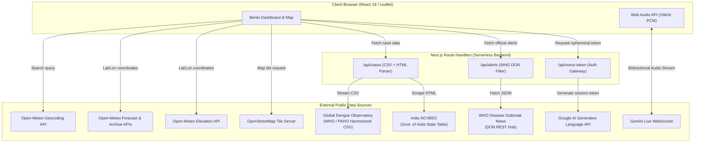
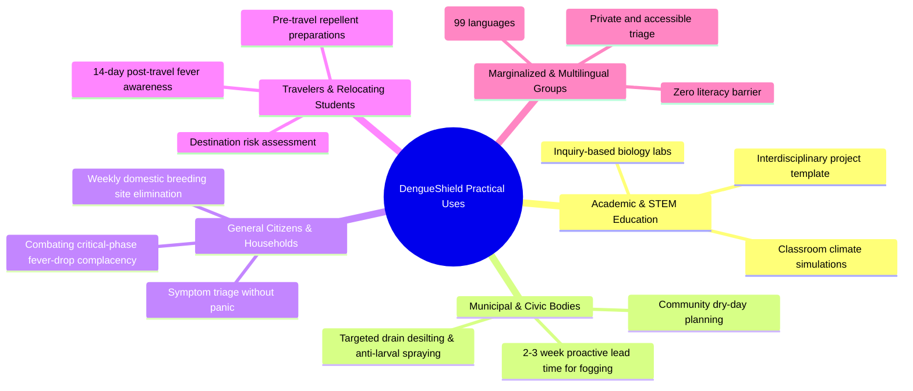

# DengueShield: Comprehensive Project Technical & Academic Master Brief
> **Document Purpose:** This document contains the exhaustive technical architecture, mathematical formulations, data engineering pipelines, epidemiological frameworks, use cases, and codebase details of **DengueShield**. It is designed to be fed directly into Claude (or any LLM/academic evaluator) to generate a formal, high-scoring Interdisciplinary Project (IDP) submission report.

---

## 1. Project Metadata & Overview

* **Project Title:** DengueShield — Location-Intelligent Dengue Surveillance, Climate Suitability Modeling, and Multilingual AI Guidance
* **Project Type:** Interdisciplinary Project (IDP) Capstone (3 Credits)
* **Target Disciplines:** Software Engineering, Epidemiology & Biomedical Sciences, Climatology & Environmental Sciences, Applied Mathematics & Data Science, Human-Computer Interaction (HCI) & AI Healthcare Ethics
* **Core Software Paradigm:** Full-stack Serverless / Reactive Web Application (Next.js App Router + Turbopack)
* **Application Status:** Fully operational, production-built educational prototype

### The Fundamental Problem Statement
Dengue fever, caused by the dengue virus (DENV-1 to DENV-4) and transmitted by *Aedes aegypti* and *Aedes albopictus* mosquitoes, is surging globally due to climate change, unplanned urbanization, and shifting monsoon patterns. However, existing public health surveillance suffers from:
1. **Significant Reporting Lags:** Official government and WHO surveillance data is updated on monthly or retrospective intervals, often lagging real-world transmission by 4–8 weeks.
2. **Scale Mismatch:** Surveillance is published at national or provincial levels, whereas transmission is hyper-local (ward or neighborhood level).
3. **Misleading Digital Tools:** Commercial health apps often attempt spurious machine-learning predictions or panic users with inaccurate "risk percentages."
4. **Literacy & Language Barriers:** Complex epidemiological dashboards are inaccessible to non-English speakers or low-literacy populations in endemic tropical zones.

**The Solution:** DengueShield bridges public health records with real-time local microclimate observations (temperature, relative humidity, 30-day precipitation, and elevation) via a transparent, biologically grounded **environmental suitability heuristic**. It complements this with official WHO outbreak notices and a secure, spoken-voice AI consultation assistant powered by Google Gemini Live over WebSockets in 99 languages—strictly engineered with medical guardrails to prevent clinical overreach.

---

## 2. Complete Technology Stack

| Layer | Technology | Version | Purpose & Implementation Details |
| :--- | :--- | :--- | :--- |
| **Framework** | Next.js (App Router) | `16.3.6` | Modern full-stack React framework utilizing Turbopack bundler, SSR for SEO/metadata, and Route Handlers for backend proxying. |
| **UI Library** | React / React-DOM | `19.3.0` | Client component state management, hooks (`useState`, `useEffect`, `useCallback`, `useMemo`, `useRef`), and reactive DOM rendering. |
| **Styling & Design** | Vanilla CSS3 | Custom (`globals.css`) | Modular **Bento Grid** layout using CSS Grid Named Areas; light/dark themes via CSS Custom Properties (`:root` / `[data-theme="dark"]`); hardware-accelerated animations; `@media (prefers-reduced-motion)` compliance. |
| **Typography** | Google Fonts | Web CDN | `DM Sans` (body text, high legibility) and `Manrope` (headings, geometric data numerals). |
| **Icons** | Lucide React | `^0.468.0` | Accessible, clean SVG iconography across dashboard cards. |
| **Mapping Engine** | Leaflet | `^1.9.4` | Keyless GIS rendering; dynamically imported on the client side (`import("leaflet")`) to prevent server-side `window` undefined exceptions; renders OpenStreetMap standard tile layers with an 8 km visual radius marker. |
| **AI / Voice API** | Google Gemini Live | `gemini-3.8-live` | Real-time, bidirectional audio-to-audio foundation model streaming over WebSockets. |
| **Audio Processing** | Web Audio API | Native Browser | Captures microphone input via `navigator.mediaDevices.getUserMedia`, downsamples audio to 16kHz mono PCM chunks for transmission, and reconstructs 24kHz audio buffers for spoken responses. |
| **Runtime Environment** | Node.js | `>=20.9.0` | Server runtime supporting Next.js Server Components, streaming fetch APIs, and cryptographic token requests. |
| **Data Parsing Tools** | Custom RegEx & CSV Streamer | Native JavaScript | Custom quote-aware CSV tokenizer for Global Dengue Observatory records; RegEx-based HTML DOM parser for scraping India's NCVBDC government portal. |

---

## 3. Data Ingestion Architecture & External APIs



### 1. Global Dengue Observatory (GDO)
* **URL:** `https://globaldengueobservatory.org/pages/www/global_dengue_data.csv`
* **Characteristics:** Monthly country-level surveillance harmonizing WHO global, WHO regional (AMRO/PAHO, SEARO, WPRO), and ministry data.
* **Engineering Pipeline:** Server fetches and streams raw CSV, parses header indices, normalizes country aliases (e.g., "United States" vs "USA", "South Korea" vs "Republic of Korea"), filters out future dates, ranks duplicated records by status hierarchy (`Observed` > `Nowcast` > `Backfilled`), and caches responses with a 15-minute TTL (`revalidate: 900`).

### 2. India National Center for Vector Borne Diseases Control (NCVBDC)
* **URL:** `https://ncvbdc.mohfw.gov.in/index4.php...`
* **Characteristics:** Official state/UT-level provisional surveillance released by the Ministry of Health and Family Welfare (MoHFW), India.
* **Engineering Pipeline:** When a selected location is within India, the server acts as an intelligent fallback scraper. It parses the multi-column HTML table, extracts the most recent reporting year, normalizes state/UT aliases, captures provisional reporting footnotes (e.g., "Provisional till 31st October"), and extracts the portal update date. Cached for 6 hours (`revalidate: 21600`).

### 3. WHO Disease Outbreak News (DON)
* **URL:** `https://www.who.int/api/hubs/diseaseoutbreaknews`
* **Characteristics:** The World Health Organization's verified epidemiological notification hub.
* **Engineering Pipeline:** Queries the JSON endpoint, cleans HTML entities, matches dengue-related titles/summaries published in the past 180 days, checks for country-name occurrences or global epidemic phrases, and returns direct URLs to WHO incident reports. Cached for 1 hour (`revalidate: 3600`).

### 4. Open-Meteo Meteorological Suite
* **Geocoding API:** Fast, keyless auto-complete place search (`count=5`) with debounced keystrokes (320ms).
* **Forecast API:** Current 2-meter air temperature (`temperature_2m`) and relative humidity (`relative_humidity_2m`).
* **Historical Weather Archive API:** Daily mean temperature, relative humidity, and precipitation sum over a rolling 30-day window (`start_date` to `end_date`).
* **Elevation API:** High-resolution digital elevation model (DEM) terrain height above sea level in meters.

---

## 4. The Biological & Mathematical Suitability Model

Unlike black-box machine learning approaches that hallucinate precise case numbers from aggregate data, DengueShield models the **environmental suitability of the vector** based on established empirical laboratory and ecological literature.

### Mathematical Formulation
$$\text{Index (\%)} = S_T \times (0.35 + 0.65 \times S_H) \times S_R \times S_E \times 100$$

Where the individual sub-indices are defined as:

#### 1. Temperature Suitability Factor ($S_T$)
Models the non-linear thermal performance curve of *Aedes aegypti* (larval development, adult biting frequency, and viral extrinsic incubation period):
$$S_T = \begin{cases} 
0.0 & \text{if } T < 13^\circ\text{C} \quad (\text{Biological cessation threshold}) \\
0.7 \times \frac{T - 13}{9} & \text{if } 13^\circ\text{C} \le T < 22^\circ\text{C} \quad (\text{Sub-optimal ramp-up}) \\
1.0 & \text{if } 22^\circ\text{C} \le T \le 32^\circ\text{C} \quad (\text{Optimal biological window}) \\
\max\left(0.05, 1.0 - \frac{T - 32}{8}\right) & \text{if } 32^\circ\text{C} < T \le 40^\circ\text{C} \quad (\text{Heat stress & mortality}) \\
0.05 & \text{if } T > 40^\circ\text{C} \quad (\text{Extreme heat baseline floor})
\end{cases}$$

#### 2. Relative Humidity Suitability Factor ($S_H$)
Accounts for adult mosquito desiccation resistance and longevity:
$$S_H = \begin{cases} 
0.15 & \text{if } H < 35\% \quad (\text{Severe desiccation risk}) \\
0.15 + 0.45 \times \frac{H - 35}{25} & \text{if } 35\% \le H < 60\% \\
0.60 + 0.40 \times \frac{H - 60}{25} & \text{if } 60\% \le H < 85\% \\
1.0 & \text{if } H \ge 85\% \quad (\text{Optimal atmospheric moisture})
\end{cases}$$

#### 3. 30-Day Cumulative Rainfall Factor ($S_R$)
Quantifies the availability of stagnant rainwater breeding habitats while penalizing extreme flushing:
$$S_R = \begin{cases} 
0.20 & \text{if } R < 15\text{ mm} \quad (\text{Dry baseline / artificial storage habitat}) \\
0.20 + 0.80 \times \frac{R - 15}{65} & \text{if } 15\text{ mm} \le R < 80\text{ mm} \\
1.0 & \text{if } 80\text{ mm} \le R \le 250\text{ mm} \quad (\text{Optimal breeding accumulation}) \\
1.0 - 0.60 \times \frac{R - 250}{200} & \text{if } 250\text{ mm} < R \le 450\text{ mm} \quad (\text{Flushing effect on larvae}) \\
0.40 & \text{if } R > 450\text{ mm} \quad (\text{Severe inundation limit})
\end{cases}$$

#### 4. Elevation Attenuation Factor ($S_E$)
Represents altitudinal limits on mosquito flight physiology, barometric pressure, and temperature drops:
$$S_E = \begin{cases} 
1.0 & \text{if } E \le 800\text{ m} \quad (\text{Full vector habitat}) \\
1.0 - \frac{E - 800}{1400} & \text{if } 800\text{ m} < E < 2200\text{ m} \quad (\text{Linear physiological decline}) \\
0.0 & \text{if } E \ge 2200\text{ m} \quad (\text{Inhospitable altitudinal ceiling})
\end{cases}$$

### Risk Classification Categorization
* **Low (0% – 19%):** Climate conditions strongly inhibit mosquito survival, flight activity, or viral replication.
* **Moderate (20% – 49%):** Marginal conditions; transmission possible primarily via indoor domestic water storage.
* **High (50% – 74%):** Favorable microclimate supporting rapid larval growth and active viral transmission.
* **Critical (75% – 100%):** Peak biological window where temperature, humidity, and rainfall synchronize for explosive vector proliferation.

---

## 5. File-by-File Codebase Walkthrough

### 1. `app/layout.js`
* Injects Leaflet stylesheet (`leaflet/dist/leaflet.css`) and custom styles (`app/globals.css`).
* Sets document `<head>` metadata (title, descriptions) and configures `<html lang="en" suppressHydrationWarning>` to prevent hydration mismatches caused by theme detection scripts.

### 2. `app/page.js` (The Client Dashboard)
* **State Management:** Manages place selection (`place`), geocoding suggestions (`suggestions`), current weather (`weather`), historical days (`history`), case surveillance (`cases`), WHO notices (`officialAlerts`), scenario simulation parameters (`sim`, `simOn`), theme (`theme`), info modals (`infoKey`), and voice session lifecycle (`voiceOn`, `voiceStatus`).
* **TrendChart Component:** Custom SVG component rendering 30 daily observations: horizontal gridlines, vertical rainfall bars (`rect`), and an SVG polyline showing temperature fluctuations over a 10°C–42°C domain.
* **MapPanel Component:** Dynamic Leaflet container that initializes the map on place change, renders an OpenStreetMap tile layer, draws a marker at the coordinates, and circles the location with an 8 km visual radius dash-array.
* **Audio Streaming Client:**
  - Connects to `navigator.mediaDevices.getUserMedia` requesting single-channel echo-canceled audio.
  - Instantiates an `AudioContext` and `ScriptProcessorNode` to downsample microphone PCM audio to 16kHz.
  - Encodes raw audio buffers to Base64 via custom helper `pcmBase64()`.
  - Establishes a raw WebSocket connection with the Gemini Live service endpoint.
  - Receives Base64 audio response chunks, converts them to 24kHz `Float32Array` buffers, and schedules seamless playback using an `AudioBufferSourceNode`.

### 3. `app/globals.css`
* Implements the responsive **Bento Grid**:
  - `desktop (>1050px)`: 12-column grid utilizing `grid-template-areas`:
    ```
    "cases cases cases cases cases cases cases index index index index index"
    "metric metric metric metric metric chart chart chart chart chart chart chart"
    "map map map map factors factors factors factors simulator simulator simulator simulator"
    "guidance guidance guidance guidance guidance guidance assistant assistant assistant assistant assistant assistant"
    ```
  - `tablet (721px-1050px)`: 6-column optimized re-stacking.
  - `mobile (<=720px)`: Single-column linear card flow.
* Interactive full-screen voice overlay with animated floating SVG oval (`@keyframes voiceFloat`) and pulsing audio waveform bars (`@keyframes voiceWave`).
* High-contrast styling, accessible focus rings (`:focus-visible`), and CSS variable design tokens.

### 4. `app/api/cases/route.js`
* Dynamic Node.js route (`runtime = "nodejs"`, `dynamic = "force-dynamic"`).
* Fetches the Global Dengue Observatory CSV dataset and the India NCVBDC table in parallel.
* Normalizes country names, eliminates accented characters, resolves historical and provisional reporting dates, and returns a harmonized JSON response payload.

### 5. `app/api/alerts/route.js`
* Node.js route querying the WHO Disease Outbreak News hub API.
* Employs regular expressions to filter news entries mentioning dengue within a 180-day window (`180 * 86400000 ms`).
* Maps country aliases and global outbreak terms, returning direct URLs to WHO incident pages.

### 6. `app/api/voice-token/route.js`
* Protects the root `GEMINI_API_KEY` by keeping it strictly server-side.
* Enforces an in-memory sliding window rate-limiter (max 8 sessions per 10 minutes per IP).
* Assembles full contextual dashboard data (location, latest cases, status, weather readings, suitability index) and embeds it into a strict public-health system prompt.
* Calls `https://generativelanguage.googleapis.com/v1beta/auth_tokens` to mint a single-use ephemeral token valid for 25 minutes.

---

## 6. Real-Life Uses & Sectoral Impact



### Spotlight 1: Student Hypothetical Scenario Testing (Inquiry-Based Learning)
The **Interactive Climate Scenario Sandbox** is designed specifically as an educational laboratory for university and high-school STEM courses:
1. **Testing Global Warming & Vector Range Expansion:**  
   Students select high-altitude locations (e.g., Bogotá, Addis Ababa, Shimla). Using the sandbox, they raise the temperature slider by $2^\circ\text{C}-4^\circ\text{C}$. They observe how the elevation attenuation ($S_E$) is overcome by the thermal factor ($S_T$), proving how planetary warming exposes previously protected mountain communities to dengue.
2. **Studying Vector Heat Tolerance & Mortality:**  
   Students can test heatwave conditions ($>38^\circ\text{C}-42^\circ\text{C}$). The suitability score drops sharply toward the 0.05 floor, teaching students the critical biological concept of the **thermal optimum**—that excessive heat kills mosquitoes and degrades the virus.
3. **The "Drought Paradox":**  
   Students can simulate zero rainfall with optimal temperatures, allowing instructors to lecture on how domestic water storage during municipal droughts decouples vector breeding from rainfall.

### Spotlight 2: Municipal Vector Control & Civic Sanitation
* **Proactive Spraying vs. Reactive Fogging:** Municipalities typically fog streets *after* hospitals report patient surges, which occurs 3–4 weeks after peak mosquito emergence. By tracking the 30-day cumulative rainfall and suitability index, sanitation teams identify when stagnant breeding pools are forming and deploy larvicides **14 to 21 days ahead of adult mosquito outbreaks**.

### Spotlight 3: General Citizens & Family Triage (The "Critical Phase")
* **Combating Fever-Drop Complacency:** Dengue's deadliest phase is the **Critical Phase (Days 3–7)**, which begins precisely when the high fever subsides (defervescence). Citizens often drop their guard when fever breaks, failing to seek care when plasma leakage, internal bleeding, and dengue shock syndrome manifest. DengueShield's triage guidance explicitly educates citizens on critical-phase warning signs.

### Spotlight 4: Travelers & Migrant Workers
* **Pre-Travel & Post-Travel Protocols:** Travelers entering tropical destinations can check real-time climate suitability and WHO outbreak notices, packing appropriate DEET repellents. If fever arises within 14 days of returning, they are guided on what information to provide their physician.

### Spotlight 5: Multilingual Voice Accessibility for Low-Literacy Groups
* **Breaking the Language Barrier:** In endemic zones across Southeast Asia, Latin America, and Africa, public health dashboards are inaccessible to illiterate or non-English-speaking populations. DengueShield allows any user to click the microphone and speak in **any of 99 supported languages** (Hindi, Bengali, Spanish, Tagalog, Swahili, etc.), receiving empathetic, spoken-audio triage education.

---

## 7. AI Ethics, Safety Guardrails & Privacy Architecture

The integration of Gemini Live inside DengueShield is governed by a strict, multi-tiered safety specification:

```
[ User Speaks into Microphone ]
          │
          ▼
[ Audio downsampled to 16kHz PCM ]
          │
          ▼
[ WebSocket Session with Gemini Live ]
    ┌────────────────────────────────────────────────────────┐
    │  System Instruction Enforcement Gate:                  │
    │  1. REFUSE unrelated queries (coding, trivia, news)   │
    │  2. FORBIDDEN from calculating personal infection odds │
    │  3. FORBIDDEN from diagnosing dengue or other illness │
    │  4. FORBIDDEN from interpreting lab results / tests    │
    │  5. MUST screen for Red Flag Emergency Warning Signs   │
    │  6. MUST recommend certified clinical consultation     │
    │  7. MUST distinguish country totals from city scale    │
    └────────────────────────────────────────────────────────┘
          │
          ▼
[ Spoken Audio (24kHz) Played Back via Web Audio API ]
```

### Privacy & Data Protection Safeguards:
1. **Zero Secret Leakage:** The root `GEMINI_API_KEY` is strictly confined to server-side memory. The client receives only a single-use token with a 25-minute hard expiry.
2. **No Location Tracking:** Exact GPS coordinates are used exclusively inside the browser for weather API calls and Leaflet rendering; coordinates are stripped and never passed to the AI prompt.
3. **No Synthetic Hallucinations:** The prompt mandates that the assistant explicitly state when case data is missing rather than inventing numbers.

---

## 8. Verification & Build Integrity

* **Build Tool:** Next.js 16 Turbopack compiler.
* **Build Verification Status:** Successfully executed `npm run build` with **exit code 0**.
* **Generated Route Manifest:**
  - `○ /` (Static Shell prerendered for maximum client performance)
  - `ƒ /api/cases` (Dynamic Server Route)
  - `ƒ /api/alerts` (Dynamic Server Route)
  - `ƒ /api/voice-token` (Dynamic Server Route)

---

## 9. Master Instructions for Claude (To Generate the Final Project Report)

> **Instructions for Claude / Report Generator:**
> When asked to create the formal IDP Project Report, use the data in this document to construct a professional, multi-chapter academic report formatted in formal GitHub Flavored Markdown (or formatted for Word/PDF conversion). The final report should contain:
> 1. **Title Page & Academic Metadata:** Interdisciplinary Project (3 Credits), Course, Department.
> 2. **Chapter 1: Introduction & Literature Review:** Global dengue burden, vector biology (*Aedes aegypti*), public health surveillance limitations, and project objectives.
> 3. **Chapter 2: Interdisciplinary Methodology:** Detailed analysis of how the 5 disciplines (Biomedical Science, Climatology, Applied Math, Software Engineering, HCI) integrate.
> 4. **Chapter 3: Mathematical & Biological Modeling:** The piecewise equations for $S_T, S_H, S_R, S_E$, biological justifications, and risk classifications.
> 5. **Chapter 4: System Architecture & Technical Implementation:** Next.js 16 App Router, REST proxy routes, WebSockets PCM pipeline, Leaflet mapping, and data flow diagrams.
> 6. **Chapter 5: Real-Life Use Cases & Sectoral Impact:** Emphasize Student Hypothetical Scenario Testing (Climate Sandbox), Municipal Vector Control, Citizen Defervescence Triage, Travelers, and Multilingual Voice Accessibility.
> 7. **Chapter 6: AI Safety, Medical Ethics & Security:** Ephemeral tokens, system prompt guardrails, and privacy protections.
> 8. **Chapter 7: Evaluation, Limitations & Future Scope:** Validation strategies against historical case series, model calibration, and roadmap.
> 9. **Chapter 8: Conclusion & References:** Official citations (WHO, PAHO, NCVBDC, Open-Meteo, Google AI).
