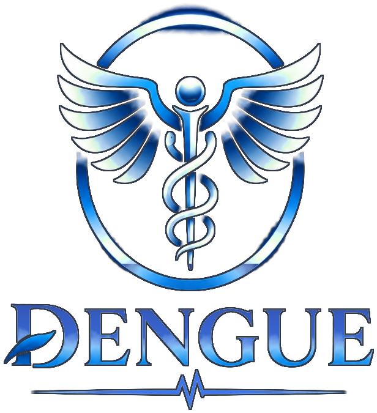

<p align="center">
  <a href="https://denguehield2k26.vercel.app/">
    
  </a>
</p>

<h1 align="center">🦟 DengueShield</h1>

<h3 align="center">Smart Dengue Surveillance & Public Health Platform</h3>

<p align="center">
  An AI-powered platform for dengue awareness, public health monitoring,
  location-based exploration, and environmental surveillance.
</p>

<p align="center">
  <a href="https://denguehield2k26.vercel.app/">
    
  </a>
  <a href="https://github.com/sujanbhowmik12/DengueShield2k26">
    
  </a>
</p>

---

## 🖥️ Website Preview

<p align="center">
  <a href="https://denguehield2k26.vercel.app/">
    
  </a>
</p>

<p align="center">
  <i>Visit the live platform to explore DengueShield.</i>
</p>

---

## 📌 About The Project

**DengueShield** is a location-based dengue surveillance and public-health awareness platform. It is designed to help users explore available dengue reports, review environmental context, understand dengue-related warning signs, and find practical prevention information.

The platform brings together public-health information, environmental data, interactive mapping, and an AI-powered voice experience in one accessible interface.

Our goal is to make dengue-related information easier to explore and understand, while supporting public awareness and informed decisions.

## ✨ Key Features

- 📊 **Surveillance Dashboard** – View the dengue case information and indicators available in the application.
- 📍 **Location-Based Exploration** – Search for a location or use browser location access to explore local context.
- 🗺️ **Hotspots GIS & Interactive Maps** – Explore geographic information through an interactive map.
- 🌦️ **Environmental Context** – Review available weather and environmental information such as temperature, humidity, and rainfall.
- 🧮 **Environmental Suitability Indicator** – Explore an educational indicator based on selected environmental factors; it is not a medical risk score.
- 🤖 **AI Health Guide** – Use the AI voice assistant for general dengue awareness information.
- 🚨 **Public Health Notices** – Find links and information related to relevant public-health notices.
- 🩺 **Symptom Checker & Awareness** – Learn about common symptoms, warning signs, and prevention practices.
- 📝 **Community Reports** – Explore community reporting features available in the application.
- 🌓 **Responsive Interface** – Use the dashboard across supported screen sizes, with light/dark appearance options.

## 🛠️ Technology Stack

| Technology / Service | Purpose |
|---|---|
| Next.js | Application framework and API routes |
| React | User interface |
| JavaScript | Application logic |
| CSS | Styling and responsive layout |
| Leaflet | Interactive maps |
| OpenStreetMap | Map tiles and geographic data |
| Google Gemini | AI-powered voice assistant |
| Open-Meteo | Weather and environmental data |
| Global Dengue Observatory | Public dengue data source |
| WHO | Public-health information and outbreak notices |
| NCVBDC India | Indian national vector-borne disease information |

## 🏗️ Project Structure

```text
DengueShield2k26/
├── app/
│   ├── api/
│   │   ├── cases/
│   │   ├── alerts/
│   │   └── voice-token/
│   ├── page.js
│   ├── layout.js
│   └── globals.css
├── components/
├── data/
├── lib/
├── public/
│   └── dengue-logo.png
├── screenshots/
│   └── homepage.png
├── .env.example
├── package.json
├── PROJECT_REPORT.md
└── README.md
```

> The tree above is a high-level illustration. Your repository may contain additional files and folders.

## ⚙️ Installation & Setup

### 1. Clone the repository

```bash
git clone https://github.com/sujanbhowmik12/DengueShield2k26.git
```

### 2. Open the project directory

```bash
cd DengueShield2k26
```

### 3. Install dependencies

```bash
npm install
```

### 4. Configure environment variables

Create a `.env.local` file in the project root and add the environment variables required by your enabled features.

```env
GEMINI_API_KEY=your_gemini_api_key
```

Keep API keys private. Do not commit `.env.local` or expose secret keys in frontend code. Check `.env.example` and the project source for any additional variables required by your setup.

### 5. Start the development server

```bash
npm run dev
```

Open [http://localhost:3000](http://localhost:3000) in your browser.

### 6. Create a production build

```bash
npm run build
npm start
```

## 🔗 Data Sources & Services

DengueShield references the following public resources and services:

- [Global Dengue Observatory](https://globaldengueobservatory.org/)
- [World Health Organization (WHO)](https://www.who.int/)
- [National Centre for Vector Borne Diseases Control (NCVBDC), India](https://ncvbdc.mohfw.gov.in/)
- [Open-Meteo](https://open-meteo.com/)
- [OpenStreetMap](https://www.openstreetmap.org/)
- [Google AI / Gemini](https://ai.google.dev/)

Availability, coverage, and update frequency depend on the respective external providers.

## ⚠️ Important Disclaimer

DengueShield is an educational and public-health awareness project. It is **not** a medical diagnostic tool, an official government surveillance system, or a clinically validated outbreak prediction platform.

Environmental indicators shown by the application are for general educational context only. They do not establish whether a person is infected, calculate an individual's probability of infection, or predict future dengue cases.

Data may be delayed, incomplete, or unavailable for some locations. For medical concerns, consult a qualified healthcare professional. For official statistics and alerts, refer to the relevant local and national health authorities.

## 🚀 Future Improvements

- Expand coverage of reliable regional public-health datasets.
- Improve data visualization and historical trend exploration.
- Add more language options for awareness content and AI assistance.
- Improve accessibility and mobile usability.
- Enhance community reporting and moderation workflows.
- Add clearer data-source, timestamp, and coverage indicators.

## 👥 Project Team

**DengueShield — 2K26**

Developed as a technology project focused on public-health awareness, dengue surveillance exploration, environmental context, and AI-assisted information access.

_Add your team members' names and GitHub profiles here._

## 🙏 Acknowledgements

We thank the open-source community and the public organizations and data providers whose resources support this project.

---

<p align="center">
  <b>🦟 DengueShield — Technology for a Healthier Tomorrow.</b>
</p>

<p align="center">
  If you find this project useful, consider giving the repository a ⭐.
</p>
